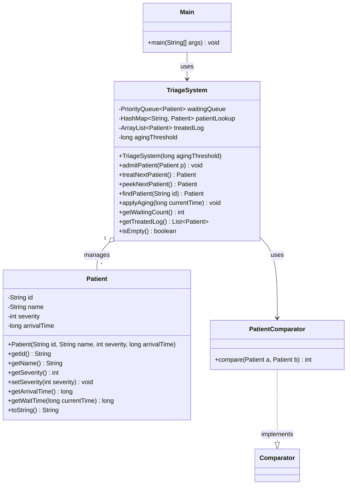

# DESIGN.md – Hospital Emergency Room Triage (Option B)

## Project Track
I chose **Option B: Hospital Emergency Room Triage (Priority Queues)**.

In an ER, patients can't just be treated first-come, first-served, because a critical patient (severity 1) might be stuck behind someone with a mild issue (severity 5). My system makes sure the most severe patients are treated first, breaks ties by who arrived earlier, and uses an "aging" rule so mild patients don't end up waiting forever.

---

## UML Class Diagram

### Class Descriptions
- **Patient**: This class stores one patient's info. Severity goes from 1 (Critical) to 5 (Mild). `arrivalTime` is stored in minutes so the wait time is easy to calculate and test.
- **PatientComparator**: This class sorts patients by severity first (lower number = higher priority). If two patients have the same severity, the one who arrived earlier goes first.
- **TriageSystem**: This is the main logic class. It holds the waiting queue, a lookup map for finding patients by ID, and a log of patients who have already been treated.
- **Main**: This is the driver class that runs a 5-step demo scenario (built in Phase 4).

---

## Data Structure Selection

### `PriorityQueue<Patient>` (waiting room)
- This is the main structure. A priority queue always keeps the highest-priority patient at the front, which is exactly what triage needs.
- I'm passing in a custom `PatientComparator`, so the queue orders patients by severity and then by arrival time instead of just insertion order.
- Java's `PriorityQueue` is backed by a binary heap, so adding and removing patients is fast (O(log n)) even when the ER is busy.

### `HashMap<String, Patient>` (patient lookup)
- A priority queue can't search efficiently, since finding a specific patient means scanning the whole heap. The `HashMap` maps a patient ID to the `Patient` object, so I can check if someone is already admitted (no duplicates) or look up their info in O(1) time.

### `ArrayList<Patient>` (treated log)
- Once a patient is treated, they get added to the end of an `ArrayList`. This keeps a record of the order patients were treated in, which is useful for the driver demo and for testing. I only ever append to it, so an `ArrayList` is the simplest choice.

### How Aging Works with the PriorityQueue
- Java's `PriorityQueue` does **not** automatically reorder itself if you change a patient's severity while they're inside it. So `applyAging()` removes patients who have waited past the threshold, bumps up their priority (for example, 4 becomes 3), and then adds them back so the heap stays in the correct order.
- A patient's severity can't go below 1, because 1 is already the highest priority.

---

## Big-O Expectations

| Operation | Method | Data Structure | Time Complexity |
|---|---|---|---|
| Admit a patient | `admitPatient()` | `PriorityQueue.offer()` + `HashMap.put()` | O(log n) |
| Treat next patient | `treatNextPatient()` | `PriorityQueue.poll()` + `HashMap.remove()` + `ArrayList.add()` | O(log n) |
| See next patient | `peekNextPatient()` | `PriorityQueue.peek()` | O(1) |
| Find patient by ID | `findPatient()` | `HashMap.get()` | O(1) |
| Apply aging rule | `applyAging()` | Loop over queue, re-insert updated patients | O(n log n) |
| Waiting count / empty check | `getWaitingCount()`, `isEmpty()` | `PriorityQueue.size()` | O(1) |

*n = number of patients currently waiting.*

---

## Edge Cases I Plan to Handle
- If someone calls `treatNextPatient()` or `peekNextPatient()` on an empty queue, the method returns `null` instead of crashing.
- If someone tries to admit a patient with an ID that's already in the system, it gets rejected.
- If someone looks up an ID that doesn't exist, `findPatient()` returns `null`.
- Severity values outside 1 to 5 are rejected when a patient is created.
- Aging never pushes severity below 1.
